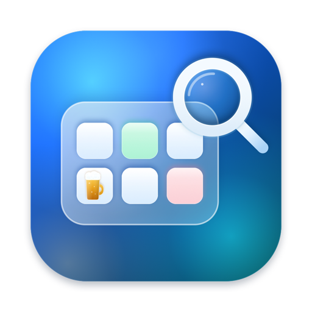
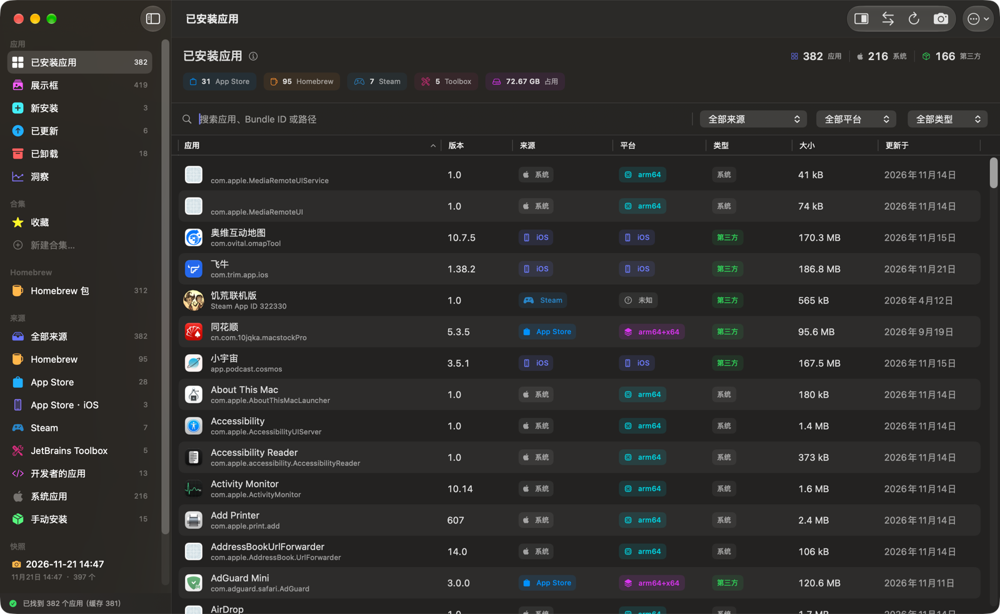
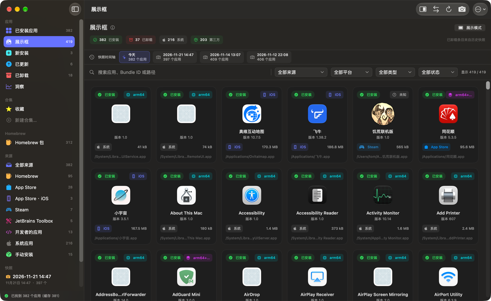
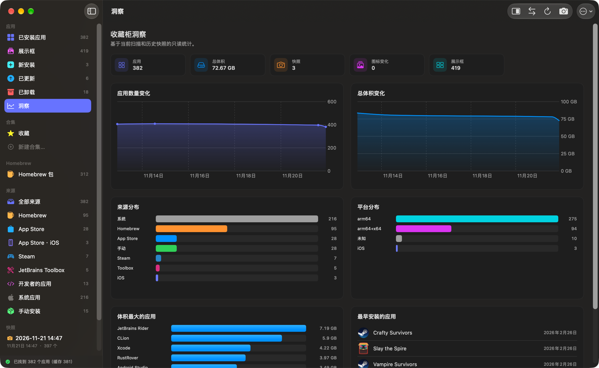
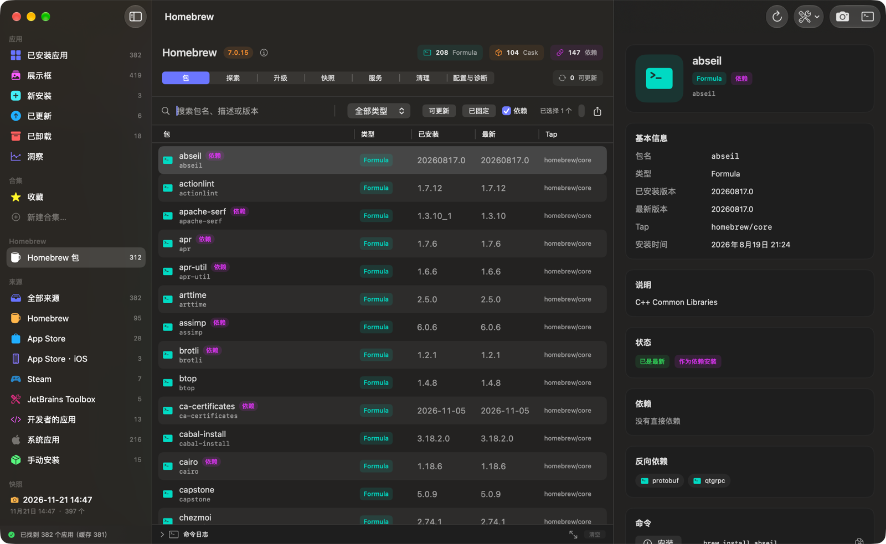

<p align="center">
  
</p>

<h1 align="center">Custocub</h1>

<p align="center">
  原生 macOS 应用清单与快照管理器。
</p>

<p align="center">
  <a href="README.md">English</a> · <a href="README.zh-CN.md">简体中文</a>
</p>

<p align="center">
  
  
  
  
</p>

> Vibe Coding而成（DeepSeek V4.1 Flash / OpenCode）

**Custocub = custos（拉丁语：守护、看守）+ cubby（收纳格）。**

Custocub 是一个用 Swift 6 / SwiftUI 编写的原生 macOS 应用清单与快照管理器。它把 Mac 上的应用收进一个清晰的清单里，说明每个应用从哪里来、运行在什么架构上、是系统还是第三方应用，并支持历史快照与快照对比。

- **版本：** 1.3（Build 3）
- **Bundle ID：** `me.whynbnb.Custocub`
- **平台：** macOS 15+
- **界面语言：** 英文 / 简体中文（默认跟随系统）
- **许可证：** MIT

## 软件截图

<table>
  <tr>
    <td width="50%" align="center">
      <br>
      <sub>已安装应用</sub>
    </td>
    <td width="50%" align="center">
      <br>
      <sub>展示框</sub>
    </td>
  </tr>
  <tr>
    <td width="50%" align="center">
      <br>
      <sub>洞察</sub>
    </td>
    <td width="50%" align="center">
      <br>
      <sub>Homebrew 包</sub>
    </td>
  </tr>
</table>

## 核心亮点

- **快速扫描**：元数据通常在 1 秒左右完成，应用体积在后台计算。
- **准确的来源识别**：系统、App Store、App Store · iOS、Homebrew、Steam、JetBrains Toolbox、手动安装。
- **平台与类型**：系统 / 第三方，以及 `arm64` / `x86_64` / 通用二进制检测。
- **开发者的应用**：使用固定前缀 `me.whynbnb.` 自动归类，可开关显示，匹配数量大于 2 时出现。
- **快照与对比**：保存历史清单、比较变化、导入导出、生成 Markdown 报告。
- **清单报告**：从「更多 → 导出报告」把当前扫描或选中的快照导出为独立 HTML、分页 PDF 或 CSV 表格。
- **快照图标历史**：图标随快照一起保存；展示框和应用详情只展示图标真正发生变化的快照。
- **Homebrew 深度支持**：独立的 Homebrew 管理界面、Formula / Cask 列表、升级中心、SOCKS5 / HTTP 代理、独立 Homebrew 快照、Brewfile 导出和实时命令日志。
- **探索完整仓库**：按近 30 天真实下载量浏览全部可安装的 Formula 与 Cask（可切换到 90 / 365 天），支持按包名、别名和描述搜索。
- **快照时间机器**：在展示框里拖动时间轴回到任意历史快照，查看那一天存在的应用、版本和图标。
- **应用档案**：把首次/最后出现、版本时间线、来源变化和图标历史汇总到一页。
- **收藏与合集**：给应用加星标，或创建自己的合集，收录已安装和已卸载的应用。
- **视觉化快照对比**：变化的应用以图标墙呈现，快照之间图标变化时并排显示新旧图标。
- **应用分享卡片**：导出包含图标、元数据、快照记录和图标历史的精致 PNG 卡片。
- **展示模式**：独立深色图标墙，控制项自动隐藏，支持切换快照和全屏。
- **命令面板**：按 ⌘K 搜索应用、快照和操作，用键盘快速跳转。
- **收藏柜洞察**：应用数量与体积趋势、来源/平台分布、最大应用和最早安装应用。
- **展示框**：浏览已安装应用，也展示历史快照中已经卸载的应用；支持状态、来源、平台、类型的多选筛选。
- **原生体验**：系统表格虚拟化、原生滚动条、可拖拽列宽和系统选择行为。
- **可选圆角图标**：默认保持应用图标原始外观，可在设置中开启圆角裁切。
- **布局记忆**：侧边栏宽度与窗口宽度分别记住，「应用清单」和「Homebrew」各有一套；应用详情面板默认收起，展开后按上次的宽度显示。
- **中英文界面**：默认跟随系统语言，也可以在设置中手动切换，切换后立即生效，无需重新启动。
- **浅色 / 深色外观**：默认跟随系统，也可以手动选择浅色或深色，立即生效。

## 功能

### 快速扫描

扫描以下应用目录，并自动去重符号链接：

- `/Applications`（含子目录）
- `~/Applications`
- `/System/Applications`
- `/System/Library/CoreServices`
- `/Library/Apple/System/Applications`

元数据直接读取 `Info.plist`；应用体积在后台测量，列表会先出现，体积随后补齐。

### 来源识别

| 来源 | 判断方式 |
| --- | --- |
| 系统应用 | 路径位于 `/System/`、`/System/Cryptexes/` 或 `/Library/Apple/` |
| App Store | `Contents/_MASReceipt/receipt`，并用 Spotlight 的 `kMDItemAppStoreAdamID` 兜底 |
| App Store · iOS | `Wrapper/*.app`、`WrappedBundle`、`iTunesMetadata.plist`，以及 `DTPlatformName` / `LSRequiresIPhoneOS` 等标记 |
| Homebrew | `/opt/homebrew/Caskroom`、`/usr/local/Caskroom` 的符号链接，以及 Cask 应用名索引 |
| Steam | `Contents/MacOS/run.sh` 中包含 `steam://run/<AppID>`，或真实游戏位于 Steam 库的 `steamapps/common` 下 |
| JetBrains Toolbox | 读取 `~/Library/Application Support/JetBrains/Toolbox/state.json` 中的 `tools[].installLocation` |
| 手动安装 | 以上规则都不匹配 |

系统应用优先级最高，因此 Apple 自带应用即使带 App Store 收据也会被标为「系统应用」。从 App Store 安装的 Xcode、Apple Configurator 等工具会正确显示为 App Store。

Steam 和 JetBrains Toolbox 使用它们自己生成的元数据/路径进行判断，而不是猜测应用名称，因此不会把直接安装的同名应用混为一谈。

### 开发者的应用

开发者的应用使用固定的 Bundle ID 前缀 `me.whynbnb.`。

- 设置中的「显示开发者的应用」开关控制该分类，默认打开
- 「开发者的应用」位于「来源」区域，与 Homebrew、Steam 等来源并列
- 匹配数量大于 2 时才显示
- 统计时真实来源优先：Homebrew、App Store、Steam 等保留自己的应用；只有仍属于「手动安装」的开发者的应用会计入该行，避免来源总数重复
- 点击「开发者的应用」筛选时，仍会显示所有匹配该 Bundle ID 前缀的应用，包括来自其他来源的应用
- 不会覆盖真实的安装来源，来源徽章和快照数据仍然保持准确

### 管理工具节点（Steam 与 JetBrains Toolbox）

Steam 客户端和 JetBrains Toolbox 客户端会作为管理工具加入各自的来源分类：

- Steam 应用出现在 **Steam** 分类中，JetBrains Toolbox 应用出现在 **JetBrains Toolbox** 分类中
- 它们带有「管理工具」标记，且不会在该分类中重复计数
- 它们仍按真实来源（如手动安装、Homebrew）计数，因此来源总数不变，并且仍然相加相等

### Homebrew 支持

侧边栏提供独立的 **Homebrew** 界面，与应用清单分开。

**版本要求**

Custocub 的 Homebrew 功能需要 **Homebrew 7.0 或更高版本**。

- 启动时用 `brew --version` 读取一次版本，界面立即知道功能是否可用
- 版本过低时，Homebrew 界面会显示专门的「Homebrew 版本过低」状态，包含当前版本、所需版本、可复制的 `brew update && brew upgrade` 命令，以及「重新检测版本」按钮
- 与 Homebrew 无关的功能（应用扫描、来源、快照、展示框）完全不受影响
- 升级 Homebrew 后，`brew update` 会自动重新检测版本并解除限制，不需要重启

**整体开关**

- Homebrew 支持**默认开启**，只有检测到本机存在 `brew` 可执行文件时才会真正生效
- 如果没有安装 Homebrew，则完全不显示也不执行任何操作：侧边栏不出现 Homebrew 入口，也不会派生 `brew` 进程
- 开关只影响 Homebrew **管理界面**，原有功能完全不受影响：
  - 应用清单中的 Homebrew 应用仍归类为 **Homebrew 来源**
  - 来源统计、系统 / 第三方划分、平台识别、展示框、体积缓存、快照行为都与之前一致
  - 应用快照照常保存，只是关闭时会跳过可选的 Cask 列表
- 关闭开关后侧边栏的 Homebrew 入口会完全消失：不执行任何 `brew` 命令、不读取包列表、也无法进入 Homebrew 界面。快照文件仍保留在磁盘上，不会被删除
- 重新开启会自动重新读取包列表

**包列表**

- 通过一次 `brew info --json=v2 --installed` 读取全部已安装包
- 区分 **Formula**（命令行包）与 **Cask**（图形界面包）
- 显示已安装版本、最新版本、Tap、安装时间、运行时依赖，以及 `outdated`、`pinned`、`auto_updates` 状态
- 支持按类型、可更新、已固定筛选，也可以搜索包名、描述和版本
- 包详情面板的命令行把操作按钮放在最前面（安装、升级、重新安装、卸载），后面是命令文本与复制按钮；卸载按钮为红色
- 包详情面板用可点击的小胶囊列出**直接依赖**与**反向依赖**，点击即可跳转到对应包的详情，左侧包列表会滚动到对应行并高亮，可以在相互依赖的包之间来回切换

**两种不同性质的快照**

| 快照 | 记录内容 | 用途 |
| --- | --- | --- |
| 应用快照 | GUI 应用 + 当时的 Homebrew **Cask** 列表 | 重建 GUI 应用集合；Cask 页可以导出后直接安装 |
| Homebrew 快照 | Homebrew **Formula + Cask** 列表 | 完整的包管理器备份，与应用清单互相独立 |

应用快照现在会额外保存 `casks` 数组。快照界面中新增 **Homebrew Cask** 页，可以复制安装命令、复制 Brewfile，或导出 Brewfile / 安装脚本。旧快照没有该字段时仍然可以正常读取，只是 Cask 列表为空。

**探索完整仓库**

「探索」分区和「包」的区别：「包」只列出这台 Mac 上已安装的包，「探索」列出 Homebrew 仓库里**全部**的 Formula 与 Cask，装没装都可以看到。

- 目录来源：`formulae.brew.sh` 官方的 `formula.json` 与 `cask.json`，和 Homebrew 自己使用的文件一致
- 下载量来源：`analytics/install/{30,90,365}d.json` 与 `analytics/cask-install/{30,90,365}d.json`，也就是 `brew formula-analytics` 背后的同一份匿名统计
- **默认显示近 30 天下载量最大的包**，可以在近 30 / 90 / 365 天之间调整统计范围，也可以调整显示条数（前 50 / 100 / 200 / 500 / 全部）
- 搜索覆盖包名、显示名、别名、描述、Tap 与版本；搜索时不受条数限制，匹配项全部列出
- 可按下载量或名称排序，按 Formula / Cask 筛选，也可以选择是否显示已弃用、已停用的包
- `#排名` 列显示该包在自己分类中的名次，占比列显示它在对应统计范围内的下载量占比
- 已安装的包会带「已安装」徽章，详情面板里同时显示已安装版本
- **先搜索再安装**：结果行直接带「安装」按钮，详情面板也可以安装；没有匹配项时可以直接用输入的名称执行 `brew install`
- 头部的「可更新」数量可以直接点击，跳转到「升级」分区
- 目录缓存在本地：目录 1 天过期，下载量 1 小时过期；命中缓存后打开探索不会发起任何网络请求

Homebrew 的全局工具栏在每个分区都完全一致。**Brewfile 导出**放在「包」分区的筛选栏里，**快照对比**放在「快照」分区的标题栏里，切换分区时工具栏不会变化。

**网络代理**

- Homebrew 设置页可以让 Homebrew 的 `curl` 请求与「探索」目录下载走 **SOCKS5** 或 **HTTP** 代理。填写主机和端口后，可以用「测试连接」验证到 `formulae.brew.sh` 的连通性
- Git 有自己的代理优先级：`git config` 里的 `http.proxy` 会覆盖 `http_proxy` / `all_proxy` 环境变量。因此 `brew update` 的 `git fetch` 默认使用 Git 配置的代理，而不是应用里的代理
- **接管 Git 代理配置（仅 brew 子进程）** 默认关闭。开启后，Custocub 会向 brew 子进程注入命令级 `http.proxy` / `https.proxy`（包括按 URL 单独设置的 `http.<url>.proxy`），让 `brew update` 也走应用代理；不会写入 Git 全局配置
- SOCKS5 使用远程 DNS（`socks5h`），域名由代理解析，不依赖本机 DNS
- 它只影响 Custocub 启动的进程，不会修改系统、Git 或 Homebrew 的配置文件
- 同一页还会**只读**显示 `git config --global` 中的代理配置，方便确认 Git 实际使用的代理，但无法在应用内修改

Homebrew 快照单独存放：

```text
~/Library/Application Support/Custocub/BrewSnapshots/<UUID>.json
```

**日常命令**

新包的安装集中在**探索**：先搜索，再在结果行上点「安装」，或在详情面板安装。

**升级**是独立分区：列出所有可更新的 Formula 与 Cask，显示已安装与最新版本，支持逐行升级、升级所选和**升级全部**，也可以点「检查更新」执行 `brew update`。工具栏不再保留升级按钮。

**升级策略**

Custocub 不会默默继承 shell 里恰好导出的 `HOMEBREW_*` 环境变量，而是给每次 brew 调用显式指定策略。可以在升级分区顶部切换，也可以在**设置 → Homebrew → 升级**里切换：

| 策略 | Cask 范围 |
| --- | --- |
| **标准** | Homebrew 自身默认行为：Formula，加上应用 bundle 版本落后于 tap 版本的自动更新 Cask；`:latest` 仍然跳过 |
| **非贪婪** | 自动更新与 `:latest` 的 Cask 完全跳过，只升级普通包 |
| **贪婪** | 一并升级自动更新与 `:latest` 的 Cask |

策略会同时作用于三处，保证列表和实际命令一致：

- `brew info --json=v2 --installed` 与 `brew outdated` 对同一批包判定为可更新，驱动「可更新」数量与升级列表
- `brew upgrade` 只在贪婪模式追加 `--greedy`
- 复制的升级命令、包详情里展示的可复制命令带同样的参数

切换策略后会立刻重新读取清单，数量和列表都不用重启或重新执行 `brew update`。

本机的差异很直观：114 个已安装 Cask 中，标准策略报告 5 个可更新，非贪婪只报告 2 个，因为其中 3 个是 `auto_updates` 且会被 Homebrew 默认接管。

卸载、重新安装、固定和取消固定仍然在包列表右键菜单和包详情面板里。

「维护」菜单还提供更新索引、清理缓存与旧版本、移除不再需要的依赖、检查环境、查看配置和查看可更新的包。

**命令日志**

Custocub 执行的每条命令都会实时写入日志：

- 以 `$` 开头的完整命令行
- 按行聚合的 stdout / stderr 实时输出
- 成功或失败的结果，附带退出码和耗时
- Homebrew 界面底部可折叠的日志面板，以及带历史记录的独立日志窗口
- 可以停止正在执行的命令：先发送 `SIGINT`，如果 Homebrew 未退出再依次发送 `SIGTERM` / `SIGKILL`

**后台服务**

新增独立的 **服务** 标签页，管理带有 `service` 定义的 Formula（postgresql、redis、nginx 等）。通过 `brew services info --all --json` 读取真实状态，而不是靠猜测：

| 字段 | 含义 |
| --- | --- |
| `status` | `started` / `stopped` / `scheduled` / `none` / `error` / `unknown` / `other` |
| `running` | 当前进程是否存活（有 PID） |
| `registered` | 是否已注册为登录（或开机）自动启动 |
| `schedulable` | 是否为定时任务（`interval` / `cron`） |

操作与 Homebrew 子命令一一对应：

| 操作 | 命令 | 效果 |
| --- | --- | --- |
| 启动 | `brew services start <name>` | 立即启动并注册自动启动 |
| 启动全部 | `brew services start --all` | 启动所有已注册服务 |
| 停止 | `brew services stop <name>` | 停止并取消自动启动 |
| 停止全部 | `brew services stop --all` | 停止并取消全部注册 |
| 重启 | `brew services restart <name>` | 必要时先停止再启动 |
| 运行一次 | `brew services run <name>` | 仅运行，不注册自动启动 |
| 立即停止 | `brew services kill <name>` | 立即结束但保留注册 |
| 停止但保留自动启动 | `brew services stop --keep <name>` | 停止但不取消注册 |
| 清理无用服务 | `brew services cleanup` | 移除失效的服务文件 |

列表会把运行中 / 已注册的服务排在前面，并标记定时任务；详情面板显示启动命令、PID、退出码、运行用户、工作目录、服务文件与日志路径，并提供「打开日志」按钮。

**配置与诊断**

单独的 **配置与诊断** 标签页整合了两项只读检查：

- `brew config` — 按分组解析展示（版本、Tap、路径、工具链、系统、环境变量），支持筛选，并保留原始输出与复制按钮
- `brew doctor` — 通过 `--json` 获取结构化结果（旧版 Homebrew 自动回退到文本解析）。按错误 / 警告 / 提示分级展示，附受影响的包、修复说明、可复制的修复命令和链接，同样可以查看原始输出

诊断过程不会修改任何内容，只做报告。

**清理**

新增独立的 **清理** 页，先分析再执行 Homebrew 的真实清理命令。分析阶段只用只读命令（`-n` 试运行 + 目录统计），在你点击执行前不会改动任何文件。

| 操作 | 命令 | 作用 |
| --- | --- | --- |
| 标准清理 | `brew cleanup` | 移除过期下载、旧版本、残留锁文件与日志。无用依赖需要在下方单独移除 |
| 移除无用依赖 | `brew autoremove` | 卸载「只作为依赖安装、且已不再被需要」的 formula |
| 清理全部缓存 | `brew cleanup --prune=all` | 删除全部下载缓存（含最新版本），保留已安装的包 |
| 清空下载缓存 | `brew cleanup --prune=all --scrub` | 连 Ruby 缓存与临时文件一并清理 |
| 修复安装前缀链接 | `brew cleanup --prune-prefix` | 只清理失效的符号链接和空目录 |

界面会分别给出标准清理与深度清理预计可释放的空间、按目录拆分的缓存占用（`downloads`、`api`、`bootsnap`）、旧版本、无用依赖，以及 `brew missing` 健康检查。破坏性操作执行前会二次确认。

**导出**

- 把当前已安装包导出为 `Brewfile`，可直接交给 `brew bundle`
- 可以只导出 Formula 或只导出 Cask，分别备份两部分
- 把任意 Homebrew 快照导出为 `Brewfile`、仅 Formula / 仅 Cask 的 `Brewfile`，或可直接执行的安装脚本
- 复制单个包的 `brew install …` 命令

Custocub 始终使用真实的 `brew` 可执行文件，因此会沿用你的安装前缀、Tap 和 Homebrew 配置。

### 平台与类型

直接读取主可执行文件的 Mach-O 头，不调用 `lipo` 子进程：

- `arm64`（Apple 芯片）
- `x86_64`（Intel）
- 通用二进制（arm64 + x86_64）
- iOS 应用
- 未知（脚本类或缺少常规可执行文件）

同时记录 Bundle ID、版本、构建号、最低系统版本、安装时间、更新时间、实际占用空间、可执行文件路径和来源。

### 快照与对比

- 一键把当前应用清单保存为历史快照
- 快照包含体积、安装/更新时间、Bundle ID、版本、架构、来源和 **PNG 图标**
- 每个快照单独存为一个 JSON 文件，重命名或写备注不会重写所有历史快照
- 支持导入、导出单个或一组快照
- 比较两个快照，列出新增、移除、更新，并显示字段级变化
- 可以把「当前状态」作为比较的一方
- 导出 Markdown 对比报告
- 对比界面包含 **视觉对比** 区域：变化的应用显示为图标卡片；两个快照都记录了图标时，会并排展示旧图标和新图标

### 清单报告

在工具栏的 **更多 → 导出报告** 中，可以把应用清单分享或归档：

- **HTML**：单个自包含文件，包含统计卡片、来源明细和适合打印的表格；即使 macOS 设置为自动隐藏滚动条，页面也会始终显示滚动条
- **PDF**：A4 分页报告，包含同样的统计和表格，适合打印或长期归档
- **CSV**：带 BOM 的 UTF-8 表格，可直接用表格软件打开，包含 Bundle ID、构建号、架构、原始字节大小、更新时间和安装路径

侧边栏选中历史快照时，报告描述该快照；否则导出当前扫描结果。

### SwiftLens 集成

如果系统里安装了 SwiftLens（`me.whynbnb.SwiftLens`），应用右键菜单会多出 **使用 SwiftLens 打开** 一项。Custocub 通过 LaunchServices 的“用其他应用打开文件”机制把 `.app` 交给 SwiftLens，系统会同时把文件读取权限授予这个沙盒应用。

SwiftLens 需要处理被打开的文件（`application(_:open:)`），才能在自己的窗口里加载该应用；它的命令行摘要模式是另一条路径。

### 展示框

「展示框」用图标网格浏览软件收藏：

- 已安装应用来自实时扫描
- **已卸载应用**来自历史快照；即使应用已经被删除，仍会继续展示快照中的图标和最后已知元数据
- 顶部 **快照时间轴**：选择「今天」或任意历史快照，展示框会切换为那一天的软件清单；之后安装的应用消失，之后卸载的应用仍然保留，顶部统计也随之变化
- 支持按已安装/已卸载、来源、平台、系统/第三方多选筛选
- 顶部统计胶囊也可以直接点击筛选：已安装、已卸载、系统、第三方
- 筛选栏右侧显示当前可见数量

侧边栏另外提供三个快照对比入口：

- **新安装**：最近一次快照之后新安装的应用
- **已更新**：版本与最近一次快照不同的应用
- **已卸载**：最近一次快照里记录过、但当前没有安装的应用

这些视图都以最近保存的快照为基准；还没有快照时，页面会提示先保存一个快照。

### 收藏与合集

- 在应用右键菜单或详情里点星标，加入 **收藏**
- 创建「开发工具」「必装应用」等自定义合集，从任意应用右键菜单添加
- 合集可以包含已安装和已卸载的应用，同样支持快照时间轴和多选筛选
- 侧边栏右键可以重命名或删除合集

### 收藏柜洞察

侧边栏的 **洞察** 页面基于当前扫描和历史快照提供只读统计：

- 应用数量和总体积的时间趋势
- 来源与平台分布
- 体积最大的已安装应用
- 最早安装的应用
- 快照数量和图标有变化的应用数量

### 命令面板

按 **⌘K** 打开键盘驱动的命令面板：

- 按名称、Bundle ID 或路径搜索已安装/已卸载应用
- 跳转到任意历史快照
- 执行扫描、保存快照、打开 Homebrew、展示框、收藏或展示模式
- 使用 ↑/↓ 选择，回车执行，Esc 关闭

### 展示模式

在展示框、收藏或任意合集中点击 **展示模式**（或按 ⇧⌘P），会打开一个独立的深色图标墙：

- 几秒后控制项自动隐藏，移动鼠标重新出现
- 可以直接在展示窗口里切换「今天」和历史快照
- 支持进入全屏，适合截屏、录屏或作为软件收藏展示
- 按 Esc 或关闭按钮返回主窗口

### 应用分享卡片

在应用详情、应用档案或右键菜单里可以导出 1200×760 的 PNG 卡片，包含图标、名称、Bundle ID、版本、大小、来源/平台/类型、首次/最后出现、快照覆盖情况以及基于快照的图标历史。

### 应用档案

从应用详情、应用列表右键菜单或展示框打开 **应用档案**，可以看到由历史快照汇总出的完整回顾：

- 首次出现、最后出现，以及出现在多少个快照中
- 版本时间线，包含来源、构建号、体积和快照日期
- 来源变化
- 基于快照的图标历史

### 图标历史

图标历史完全来自已保存的快照：

- 每个快照都会保存应用图标；Custocub 比较相邻快照，只列出图标真正发生变化的快照
- 连续多个快照图标相同时只保留一条；图标变化后又恢复时，两次变化都会出现
- 展示框卡片上的时钟角标可以打开图标历史，右键菜单里也有 **查看图标历史…**
- 应用详情面板会显示横向的 **图标历史** 时间线，以及图标最后一次变化的快照

不再单独记录扫描时的图标变化。想要更完整的图标历史，就在应用更新后保存快照。

## 性能说明

**内存原则**

- 历史快照不可变，磁盘上的原始快照始终是唯一数据源
- 内存里只保留派生出的轻量元数据；删除 `SnapshotCache` 只会触发重建
- 快照图标保存为侧车 PNG，只有卡片、对比、档案或分享卡片真正显示时才读取
- 原生表格、192px 快照图标分辨率和现有功能都保持不变
- 从旧版本升级后的第一次启动会构建一次缓存，之后直接复用

- **体积缓存**：`~/Library/Application Support/Custocub/size-cache.json`
  - 应用更新时间或安装时间变化时自动失效
  - 缓存最长保留 7 天
  - 未变化的应用不会在每次扫描时重新遍历文件
  - 设置 → 数据 → **清除体积缓存并重算** 可强制重新测量
- **异步图标**：图标在主线程外按需加载，只在行出现时读取。内存中缓存 256px 缩略图并限制为 48 MB，不再保留原始大图。
- **快照载荷按需读取**：不可变的历史快照 JSON 留在磁盘，内存里只保留派生出的轻量元数据；快照图标保存为侧车 PNG，只有卡片、对比或档案真正显示时才读取。
- **按住 ⌥ 点击「扫描应用」** 触发全量刷新：按钮会变成橙色，重新生成所有图标、重新测量所有应用体积，不经过缓存
- **批量更新体积**：不会每完成一个应用就刷新整张表
- **原生 SwiftUI Table**：由 NSTableView 提供虚拟化、系统滚动条和可拖拽列宽
- **切换来源时重建表格**：避免对数百行执行删除动画，保持界面响应

首次体积扫描需要遍历应用包，可能较慢；之后的扫描会复用缓存。元数据扫描本身很快。

## 构建

仓库中已经包含生成好的 Xcode 工程：

```bash
open Custocub.xcodeproj
```

选择 `Custocub` scheme 运行。

命令行构建：

```bash
xcodebuild -project Custocub.xcodeproj \
  -scheme Custocub \
  -configuration Debug \
  -derivedDataPath build/DerivedData \
  CODE_SIGNING_ALLOWED=NO build
```

修改 `project.yml` 后重新生成工程：

```bash
xcodegen generate
```

### 重新生成应用图标

图标完全由代码绘制。重新生成全部 macOS 尺寸：

```bash
swift Tools/GenerateAppIcon.swift
```

脚本会把完整的 AppIcon PNG 写入 `Custocub/Resources/Assets.xcassets/AppIcon.appiconset`。图标内容位于 macOS 标准的圆角矩形内，四周保留透明边距并带一层柔和投影，因此在 Dock、Finder 和软件内部都能保持一致的显示效果。

工程设置：

- Marketing Version：`1.3`
- Current Project Version：`3`
- Bundle Identifier：`me.whynbnb.Custocub`

## 数据位置

快照：

```text
~/Library/Application Support/Custocub/Snapshots/<UUID>.json
```

Homebrew 快照：

```text
~/Library/Application Support/Custocub/BrewSnapshots/<UUID>.json
```

体积缓存：

```text
~/Library/Application Support/Custocub/size-cache.json
```

派生的快照缓存（可随时删除并自动重建）：

```text
~/Library/Application Support/Custocub/SnapshotCache/
```

收藏与合集：

```text
~/Library/Application Support/Custocub/collections.json
```

Custocub 未启用 App Sandbox，只读取应用目录并写入自己的 Application Support 数据。它不会上传应用清单；只有下载 Homebrew 目录以及执行 Homebrew 命令时才会联网。

## 快捷键

| 快捷键 | 操作 |
| --- | --- |
| `⌘R` | 重新扫描应用 |
| `⌘S` | 保存当前快照 |
| `⇧⌘O` | 导入快照 |
| `⇧⌘E` | 导出当前快照 |
| `⇧⌘B` | 打开 Homebrew 界面 |
| `⇧⌘S` | 保存 Homebrew 快照 |
| `⌘K` | 打开命令面板 |
| `⇧⌘P` | 打开展示模式（展示框、收藏或合集） |
| `⌘,` | 打开设置 |

## 工程结构

```text
Custocub/
├─ App/
│  ├─ CustocubApp.swift          # App 入口与菜单命令
│  ├─ CustocubStore.swift        # 扫描、快照、展示框和选择状态
│  ├─ BrewStore.swift            # Homebrew 清单、快照与命令日志
│  ├─ AppPreferences.swift       # 持久化偏好键
│  ├─ BrewProxySettings.swift    # Homebrew 代理设置
│  ├─ Localization.swift         # 中英文即时切换
│  └─ WorkspaceLayout.swift      # 侧边栏、窗口与详情面板布局记忆
├─ Models/
│  ├─ AppSource.swift            # 来源与平台枚举
│  ├─ AppRecord.swift            # 应用记录
│  ├─ AppSnapshot.swift          # 快照模型
│  ├─ AppChange.swift            # 快照对比与 Markdown 报告
│  ├─ GalleryItem.swift          # 展示框条目
│  ├─ AppCollection.swift        # 收藏与自定义合集
│  ├─ AppIconHistory.swift       # 基于快照的图标历史
│  ├─ AppStory.swift             # 应用档案
│  ├─ BrewPackage.swift          # Homebrew 包记录与 Cask 快照条目
│  ├─ BrewVersion.swift          # 版本号解析与最低版本限制
│  ├─ BrewCatalog.swift          # 探索目录条目、下载量统计与筛选条件
│  ├─ BrewSnapshot.swift         # Homebrew 快照模型与 Brewfile 生成
│  └─ BrewUpgradePolicy.swift    # 标准 / 非贪婪 / 贪婪升级策略
├─ Services/
│  ├─ AppScanner.swift           # 目录发现、Info.plist、来源识别
│  ├─ HomebrewIndex.swift        # Caskroom 索引
│  ├─ SteamDetector.swift        # Steam 快捷方式与库识别
│  ├─ JetBrainsToolboxIndex.swift # Toolbox 安装路径索引
│  ├─ MachOReader.swift          # Mach-O 架构解析
│  ├─ DirectorySize.swift        # 应用体积
│  ├─ SizeCache.swift            # 持久化体积缓存
│  ├─ IconProvider.swift         # 图标加载、预取与快照 PNG
│  ├─ SnapshotRepository.swift   # 快照持久化
│  ├─ InventoryReport.swift      # HTML / PDF / CSV 清单报告
│  ├─ SwiftLensIntegration.swift # SwiftLens 检测与打开文件
│  ├─ BrewService.swift          # brew 定位、流式执行与 JSON 清单
│  ├─ BrewSnapshotRepository.swift # Homebrew 快照持久化
│  ├─ BrewCleanupService.swift   # 清理分析：缓存、旧版本、无用依赖
│  ├─ BrewHealthService.swift    # brew config / doctor 解析
│  ├─ BrewServicesService.swift  # brew services 解析
│  ├─ BrewCatalogService.swift   # 探索目录下载、缓存与解析
│  └─ GitProxyService.swift      # 只读 Git 代理检查
├─ Views/
│  ├─ ContentView.swift
│  ├─ SidebarView.swift
│  ├─ AppListView.swift
│  ├─ GalleryView.swift
│  ├─ AppDetailView.swift
│  ├─ ComparisonView.swift
│  ├─ SettingsView.swift
│  ├─ AppStoryView.swift         # 应用档案页
│  ├─ AppShareCard.swift         # 1200×760 PNG 分享卡片
│  ├─ IconHistoryView.swift      # 快照图标历史时间线
│  ├─ InsightsView.swift         # 只读收藏柜洞察
│  ├─ CommandPaletteView.swift   # ⌘K 命令面板
│  ├─ GalleryPresentationView.swift # 独立展示模式窗口
│  ├─ HomebrewView.swift         # Homebrew 包列表、筛选与安装
│  ├─ BrewSnapshotListView.swift # Homebrew 快照与 Brewfile 导出
│  ├─ BrewComparisonView.swift   # Homebrew 快照对比
│  ├─ BrewPackageDetailView.swift # Formula / Cask 详情与命令
│  ├─ BrewConsoleView.swift      # 实时命令日志与历史
│  ├─ BrewCleanupView.swift      # 清理分析与操作
│  ├─ BrewHealthView.swift       # 配置与诊断
│  ├─ BrewServicesView.swift     # 后台服务管理
│  ├─ BrewExploreView.swift      # 全量目录浏览与搜索
│  ├─ BrewUpgradeView.swift      # 可升级列表、逐行与批量升级
│  ├─ BrewCatalogDetailView.swift # 目录条目详情面板
│  ├─ Components.swift
│  └─ FileActions.swift
└─ Resources/Assets.xcassets
```

## 许可证

Custocub 以 [MIT License](LICENSE) 开源发布。

Copyright © 2026 0x574859。

## 鸣谢

感谢各大模型公司，感谢 DeepSeek，感谢各种公益站。没有 token，我就没办法做大量测试并做出这个软件（虽然还是拖延了几个月）。

最后，也感谢 macOS 上最好用的包管理器 Homebrew。


